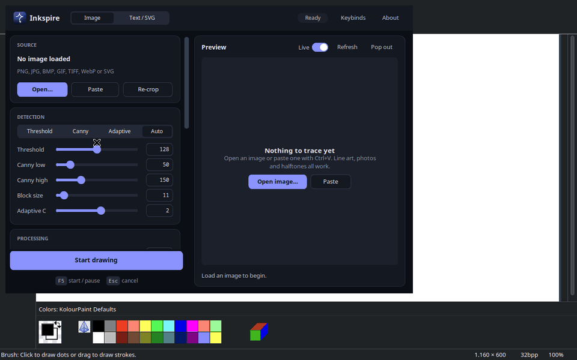
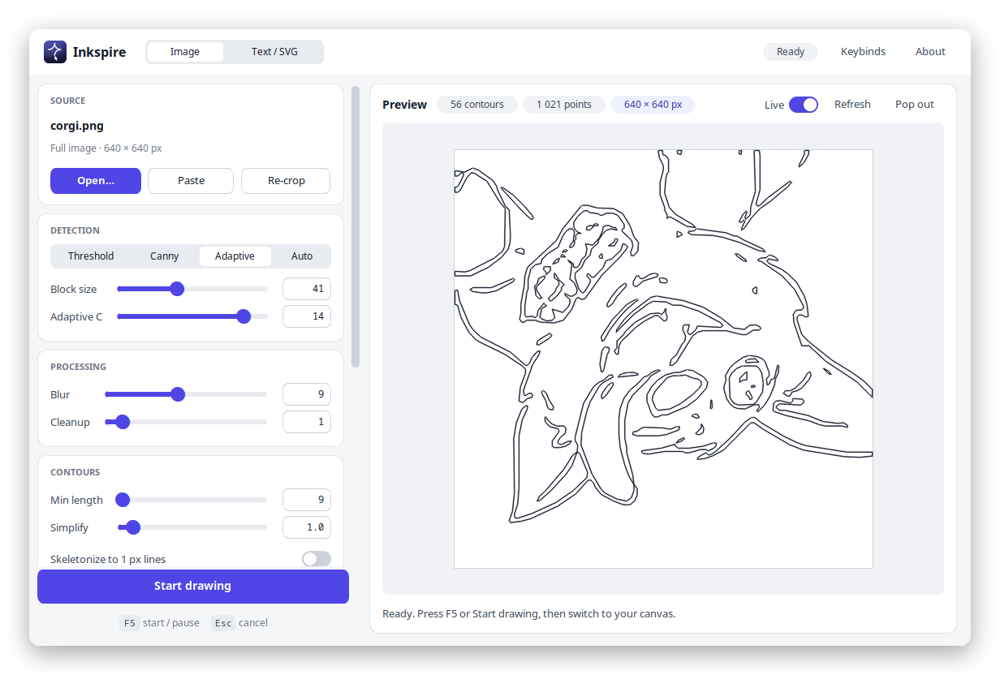
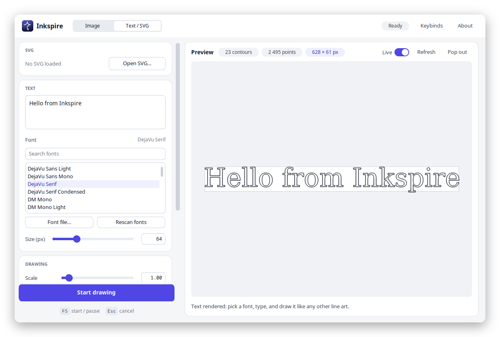
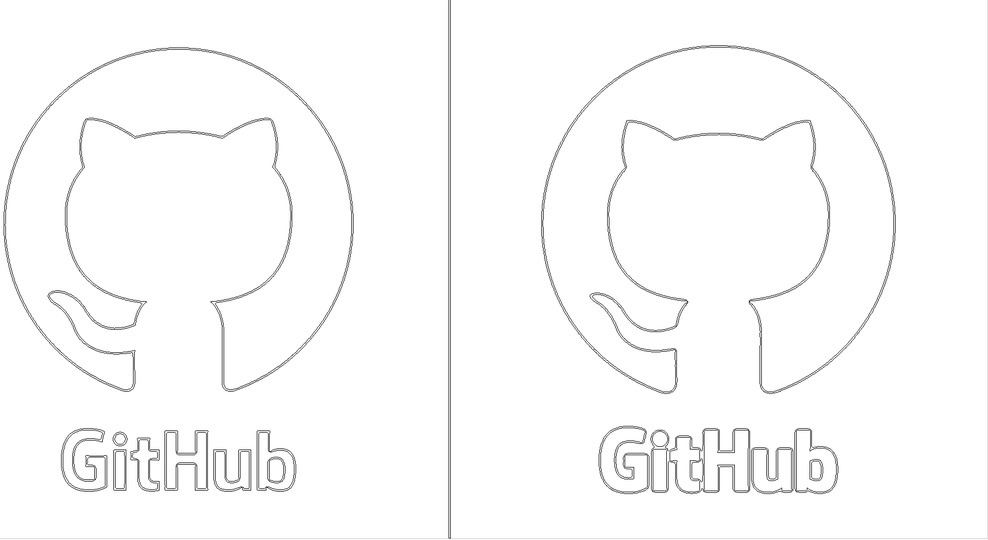

# Inkspire

Inkspire traces line art by moving the mouse along contours extracted from images, SVGs, or text. It drives drawing applications that accept synthetic pointer input, using native `ctypes` calls for low-latency mouse control on Linux (X11), Windows, and macOS.



| Image mode | Text / SVG mode |
|------------|-----------------|
| <picture><source media="(prefers-color-scheme: dark)" srcset="assets/screenshots/image-dark.png"></picture> | <picture><source media="(prefers-color-scheme: dark)" srcset="assets/screenshots/text-dark.png"></picture> |

## Examples

| Source | Result |
|--------|--------|
|  |  |
|  |  |

## Features

- **Multiple detection modes** – threshold, Canny edge, adaptive threshold, and auto-detect for black & white line art, colored images, and halftones.
- **Text and SVG input** – render text from system fonts or load SVG paths directly, with independent settings.
- **Cross-platform** – Linux (X11 and Wayland via Xwayland), Windows, and macOS, with native mouse and keyboard control via `ctypes` (XTest, `SendInput`, Quartz `CGEvent`).
- **Live preview** – a docked preview redraws the contours as you tune parameters, and pops out into its own window when you need more room.
- **Canvas picker** – drag-select your target drawing area on screen.
- **Pause/resume** – F5 toggles start, pause, and resume. Escape cancels.
- **Path optimization** – optional nearest-neighbor reordering to minimize pen-up travel between contours.
- **Session persistence** – settings, source file, and tab state are restored automatically on next launch.
- **Customizable keybinds** – reassign the start/pause and cancel keys from the Keybinds dialog.
- **Light and dark theme** – follows the system setting on all three platforms.

## Install

Download the build for your platform from [Releases](https://github.com/Maksim-Nikolaev/inkspire/releases):

| Platform | File |
|----------|------|
| Linux (x86_64) | `inkspire.tar.gz` – extract and run `./inkspire` |
| Windows (x86_64) | `inkspire.exe` |
| macOS (Apple Silicon, macOS 13+) | `inkspire-macos-arm64.dmg` |
| macOS (Intel, macOS 14+) | `inkspire-macos-x86_64.dmg` |

### macOS first launch

The macOS builds are not notarized yet, so Gatekeeper stops the first launch:

1. Open the DMG and drag Inkspire to Applications.
2. Open Inkspire. When macOS says it cannot verify the developer, go to System Settings → Privacy & Security and click **Open Anyway** (on older macOS versions, right-click the app and choose Open). Alternatively run `xattr -dr com.apple.quarantine /Applications/Inkspire.app`.
3. On first launch Inkspire explains and requests **Accessibility** access, which macOS requires before an app may move the pointer and click. Click **Open System Settings**, switch Inkspire on under Privacy & Security → Accessibility, and return to Inkspire. The prompt closes by itself once access is granted.
4. Builds without a Developer ID signature get a new code signature with every update, so macOS may forget the permission after updating. If drawing does nothing, remove Inkspire from the Accessibility list with − and add it again.

Mac keyboards send media keys from the top row unless you hold fn, so press **fn+F5** to start, or pick another key under Keybinds. The global start and cancel keys are read with `CGEventSourceKeyState`; whether that needs extra permission while another app has focus is untested, so use the on-screen buttons if the keys do not react.

## Run from source

- Python 3.10+
- **Linux:** X11 or Wayland session, system packages:
  ```bash
  sudo apt install python3-tk python3-venv libx11-6 libxtst6 xclip
  ```
- **Windows and macOS:** Python from [python.org](https://www.python.org/downloads/) (it includes Tk).
- Python packages, in a virtual environment (Debian and Ubuntu refuse a system-wide `pip install`):
  ```bash
  python3 -m venv .venv
  .venv/bin/pip install .
  ```

```bash
.venv/bin/python main.py
```

On Windows the venv commands are `.venv\Scripts\pip` and `.venv\Scripts\python`.

1. Open an image (**Open…** or Ctrl+V), or switch to **Text / SVG** to type text or open an SVG.
2. Adjust the detection settings. The preview updates as you go; turn off **Live** to update it only on **Refresh**.
3. Choose where to draw: **At pointer** starts with the mouse pointer as the bottom-left corner, **Pick area on screen…** drag-selects a fixed area and fits the drawing into it.
4. Press **F5** (or click **Start drawing**) and switch to your drawing app during the countdown. F5 pauses and resumes, Escape cancels.

On Linux, Open… uses the desktop's own file picker (kdialog on KDE, zenity elsewhere) when one is installed.

## Wayland notes

Inkspire runs under Wayland through Xwayland and injects input via the XTest extension. Requirements and caveats:

- **Xwayland 23.2+ with libei** and a compositor that bridges XTest to Wayland (KDE Plasma 6.1+, GNOME 46+). Older Xwayland cannot reach native Wayland apps.
- **Grant remote input on first draw.** The first drawing action triggers a "remote control / remote desktop" permission prompt from the desktop portal. Approve it (and choose *remember*) or nothing will move: the injected pointer and clicks are silently dropped until the `remote-desktop` portal permission is granted.
- **Global F5/Escape** while another app is focused rely on reading the keyboard across apps. On KDE, enable *System Settings → Apps & Windows → Legacy X11 App Support → allow legacy apps to read all keystrokes*. Otherwise use the on-screen Start/Pause button, or keep Inkspire focused.
- **At pointer** reads the pointer position through Xwayland, which only knows it while the pointer is over an X11 window. Use **Pick area on screen…** when drawing into a native Wayland app.
- **Canvas picker** cannot capture a screenshot on Wayland, so its overlay shows a translucent tint instead of a live screen preview. Drag-to-select still returns the correct screen coordinates.

## Building

`./build.sh` builds with PyInstaller into `builds/`: a single-file binary packed as `inkspire-linux.tar.gz` on Linux, or a DMG on macOS.

The [release workflow](.github/workflows/release.yml) builds Linux, Windows, and macOS (arm64 and x86_64) on every pull request and manual run, starts each build with `--self-test`, and publishes a GitHub Release with all four files when a `v*` tag is pushed. macOS Developer ID signing and notarization switch on once these repository secrets exist: `MACOS_CERTIFICATE` (base64 `.p12`), `MACOS_CERTIFICATE_PASSWORD`, `MACOS_CODESIGN_IDENTITY`, `NOTARY_KEY` (base64 App Store Connect `.p8`), `NOTARY_KEY_ID`, and `NOTARY_ISSUER_ID`.

## License

Released under the [MIT License](LICENSE).
